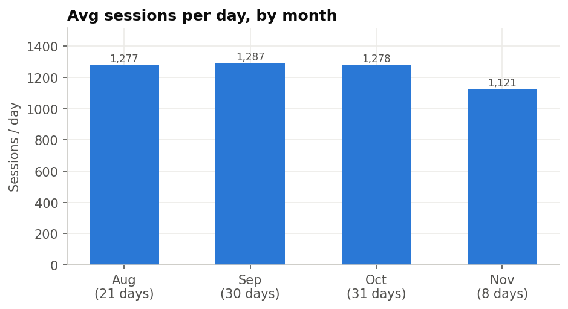
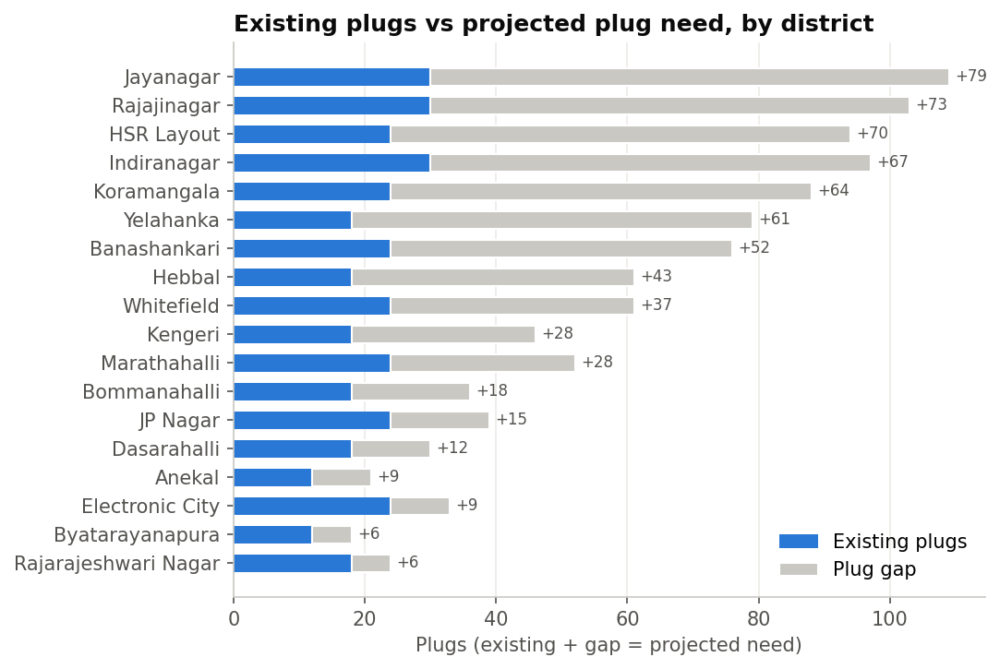
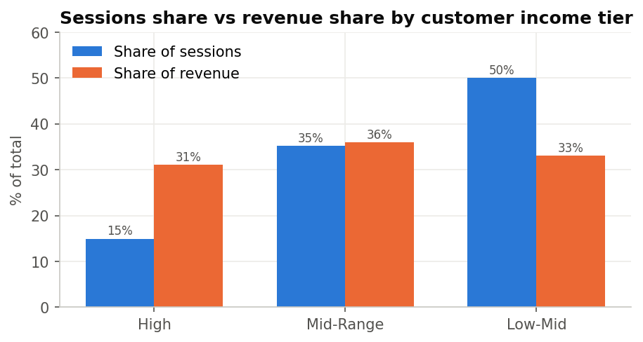
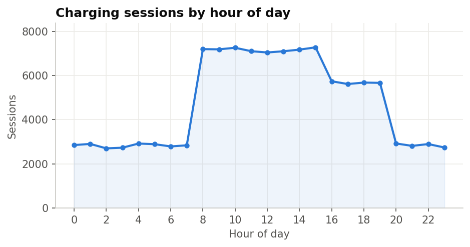
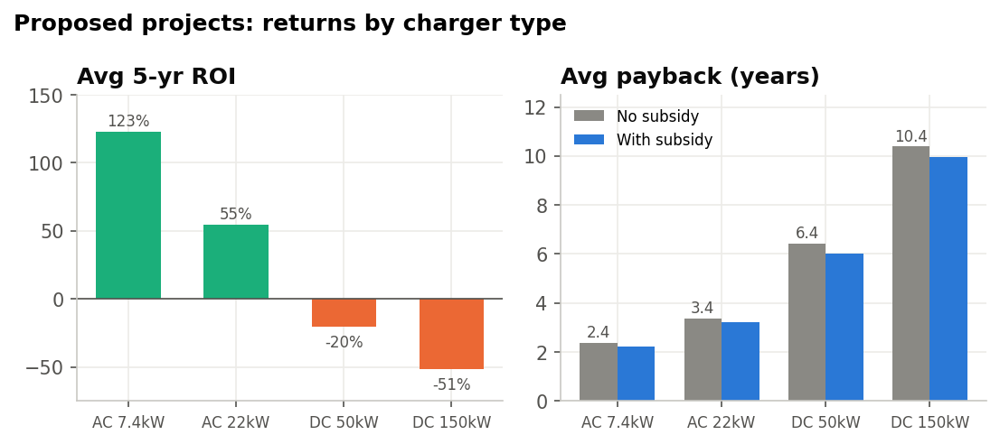
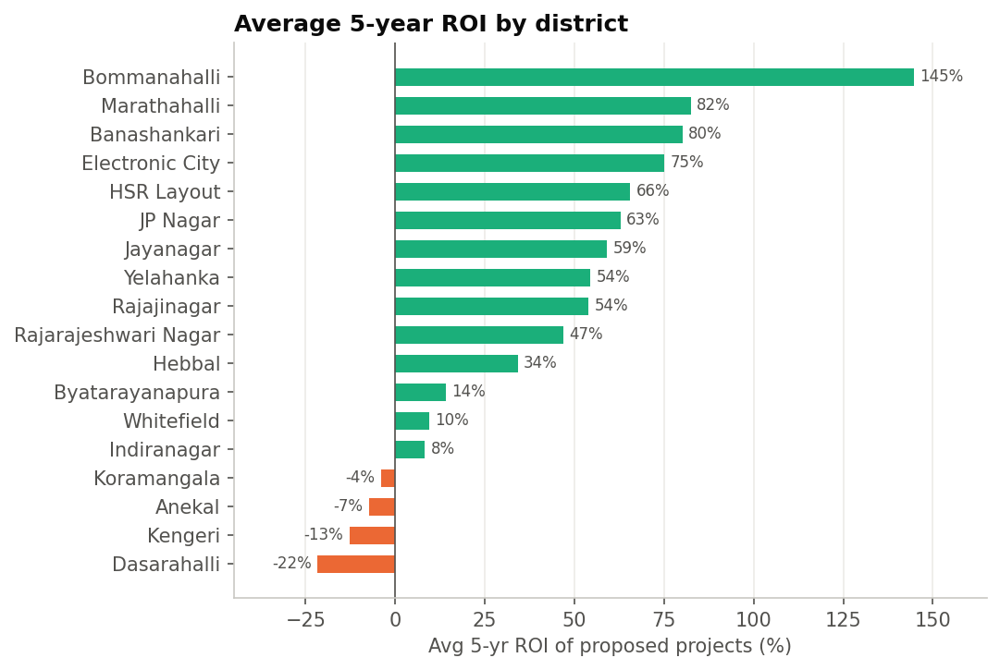

# ⚡ Tata Power EV Charging Network – Bengaluru Expansion Analysis

**Excel (Power Query · Power Pivot · DAX · PivotTables · Dashboards) + Python (pandas · matplotlib)**

An end-to-end data analysis of Bengaluru's public EV charging network. The project measures how the current network is used, who the customers are, and which of 98 proposed charging-station projects Tata Power should fund first.

📊 **Excel dashboards:** [`TATA_POWER_PROJECT.xlsx`](TATA_POWER_PROJECT.xlsx)  
📄 **Insights report (PDF):** [`reports/Tata_Power_EV_Insights_Report.pdf`](reports/Tata_Power_EV_Insights_Report.pdf)  
🐍 **Reproducible analysis:** [`analysis/tata_power_ev_analysis.py`](analysis/tata_power_ev_analysis.py)

---

## 📌 Business problem

Tata Power wants to expand its EV charging footprint in Bengaluru. Leadership needs answers to four questions:

1. How well is the existing network (65 stations, 5 operators) being used?
2. Which customer segments drive sessions and revenue?
3. Where is supply falling short of projected EV demand?
4. Which proposed projects give the best return, and how much capital do they need?

## 🗂️ Dataset

Five related tables (synthetic, modelled on the real Bengaluru market). Sessions cover **11 Aug – 8 Nov 2024**.

| Table | Rows | Description |
|---|---:|---|
| `charging_sessions.csv` | 114,000 | One row per charging session: customer, station, time, kWh, tariff, cost |
| `charging_stations.csv` | 65 | Station master: district, operator, plugs, latitude/longitude |
| `customers.csv` | 8,000 | Income tier, car model, battery capacity |
| `districts.csv` | 18 | Projected EVs, plugs and regular customers per district |
| `roi_bengaluru_districts.csv` | 98 | Proposed projects: CAPEX breakdown, revenue, OPEX, EBITDA, payback, subsidy, 5-yr ROI, priority tier |

Full column definitions: [`Tata Power/data_dictionary_Tata_Power.txt`](Tata%20Power/data_dictionary_Tata_Power.txt)

**Data model (Power Pivot):**

```
customers ──< charging_sessions >── charging_stations >── districts ──< roi_bengaluru_districts
 (customer_id)                       (station_id)        (district_name)      (District)
```

## 🛠️ What I did

| Step | Work |
|---|---|
| **Data cleaning** | Reclassified 23 negative-ROI projects from *Medium* to *Low* priority. Added `Capitalized_Land_Lease_10yr_Lakh` so the CAPEX formula can be traced (Ind AS 116). Verified `total_cost = kWh × tariff` on all 114k rows. Checked every foreign key. Flagged `plugs_count` (all stations = 6) as a likely placeholder. |
| **Feature engineering** | Added a `Battery Band` customer segment (Small / Medium / Large kWh) and Month / Month Index / Year columns from the session timestamp. |
| **Data modelling** | Loaded all 5 tables via Power Query into the Power Pivot data model and set up the relationships. |
| **DAX measures** | Total Sessions, Total kWh, Total Plugs, Sessions per Plug, Avg kWh per Station/Session, Over- and Under-utilised Stations, Unique Customers, Sessions / Revenue per Customer, Plug Gap, Projected EVs, Existing Stations, Avg CAPEX, Avg Payback (with and without subsidy), Avg 5-yr ROI |
| **Analysis** | 33 PivotTables with slicers for Month, Income Tier, Charger Type and Priority Tier |
| **Dashboards** | 4 interactive dashboards with 21 charts (see below) |
| **Validation and report** | Re-computed every headline figure in Python, generated the charts and wrote the PDF insights report |

### Dashboards

| # | Dashboard | What it shows |
|---|---|---|
| 1 | **Station Utilization & Operational Efficiency** | KPI cards (sessions, energy, revenue, customers, avg kWh and revenue per session), monthly energy vs revenue, monthly sessions, existing stations vs projected EV demand, usage by income tier |
| 2 | **Business & Usage Overview** | Stations, plugs, sessions per station, plugs vs sessions by district, station density, avg kWh per station, load distribution, top and bottom 10 stations by sessions per plug |
| 3 | **Customer & Demand Behavior** | Revenue per customer, sessions per customer, share of sessions vs share of revenue by income tier, top 10 car models, sessions by battery band |
| 4 | **Financial Performance & Expansion Strategy** | Avg CAPEX, revenue, EBITDA, payback with and without subsidy, 5-yr ROI by district, payback by charger type, CAPEX breakdown, priority tier mix, plug gap by district |

> 💡 To show the dashboards on GitHub, add screenshots to a `dashboards/` folder and link them here, e.g. ``.

---

## 📈 Key metrics

| Metric | Value | Metric | Value |
|---|---:|---|---:|
| Charging sessions | **114,000** | Stations / Plugs | **65 / 390** |
| Energy delivered | **2.86 GWh** | Sessions per plug | **292** |
| Session revenue | **₹4.97 Cr** | Avg kWh / session | **25.1** |
| Unique customers | **8,000** | Avg revenue / session | **₹436** |
| Proposed projects | **98** | Avg CAPEX / project | **₹142 L** |
| Avg payback (no subsidy / with subsidy) | **4.61 / 4.34 yrs** | Avg 5-yr ROI | **41.4%** |

## 🔍 Key insights

**1. Demand is steady, and it exceeds capacity.**  
The network handles about **1,280 sessions a day**, flat from August to November. The apparent "November drop" in the monthly chart only reflects 8 days of data. Every station serves 272–310 sessions per plug (CV 2.6%), so the network is capacity-bound rather than location-bound.



**2. Bengaluru needs 2.7× its current plugs.**  
Projected need is 1,067 plugs and there are 390 today, a **gap of 677**. Jayanagar, Rajajinagar, HSR Layout, Indiranagar and Koramangala account for **52%** of the gap.



**3. High-income customers are worth 3× more.**  
High-income customers make **15% of sessions but bring in 31% of revenue** (₹12,979 per customer vs ₹4,109 for Low-Mid). Low-Mid customers make 50% of sessions with small batteries (16.6 kWh per session).



**4. Usage peaks in the daytime.**  
Usage is concentrated between 08:00 and 15:00. The 23:00–05:00 window runs at about 37% of peak, which leaves room for off-peak pricing and fleet charging.



**5. The market is split evenly among operators.**  
Each of the five operators runs 13 stations and earns 19–21% of revenue. Tata Power is at 19.1% (₹7.32 L per station, against ₹8.07 L for ChargeZone), so it has no scale advantage yet.

**6. AC chargers produce the returns.**  
**All 54 High-priority projects are AC Level-2.** AC 7.4 kW averages a 123% 5-yr ROI and a 2.4-yr payback. DC Fast averages –20% and DC Ultra-Fast –51% (10.4-yr payback). 37 of 98 projects have a negative 5-yr ROI.



**7. Mid-Range districts beat premium ones.**  
Mid-Range districts average a 67% ROI and High-income districts only 4%, because the high-income proposals lean on expensive DC chargers on high-lease land. Residential Complexes (61%) and Bus Depots (52%) are the best site types. Malls are the weakest (28%).



## ✅ Recommendations

1. **Fund the 54 High-priority AC projects first:** ₹49.8 Cr CAPEX, ₹19.1 Cr EBITDA a year, about a 2.6-year portfolio payback. Phase them by plug gap.
2. **Pause or redesign DC fast-charging:** keep it only for corridor or fleet sites with guaranteed volume.
3. **Rework the Indiranagar, Koramangala and Whitefield proposals:** demand there is strong but the planned projects return little. Use AC chargers at residential and office sites instead.
4. **Raise revenue per session:** loyalty plans for High and Mid-Range customers, time-of-day pricing, and fleet partnerships.
5. **Claim every subsidy:** 55 eligible projects, about 0.5 years off payback, ₹7.8 Cr in total.
6. **Improve the data:** check `plugs_count` in the field, capture session duration, and extend the history to 12 months.

---

## 📁 Repository structure

```
Tata-Power-Analysis/
├── TATA_POWER_PROJECT.xlsx          # Excel workbook: data model, DAX, 33 pivots, 4 dashboards
├── Tata Power/                      # Raw data
│   ├── charging_sessions.csv
│   ├── charging_stations.csv
│   ├── customers.csv
│   ├── districts.csv
│   ├── roi_bengaluru_districts.csv
│   └── data_dictionary_Tata_Power.txt
├── analysis/
│   └── tata_power_ev_analysis.py    # Validates metrics, exports charts, builds the PDF
├── images/                          # Charts used in this README and the report
├── reports/
│   └── Tata_Power_EV_Insights_Report.pdf
├── requirements.txt
└── README.md
```

## ▶️ How to reproduce

```bash
git clone https://github.com/mahendta-9928/Tata-Power-Analysis.git
cd Tata-Power-Analysis
pip install -r requirements.txt
python analysis/tata_power_ev_analysis.py
```

To explore the dashboards, open `TATA_POWER_PROJECT.xlsx` in Microsoft Excel 2016 or later (Windows). The data model needs Power Pivot. Use the slicers on each dashboard to filter.

## 🧰 Skills demonstrated

`Data Cleaning` · `Data Modelling (Star Schema)` · `Power Query` · `Power Pivot` · `DAX` · `PivotTables & Slicers` · `Dashboard Design` · `KPI Definition` · `Financial Analysis (CAPEX, EBITDA, Payback, ROI)` · `Python / pandas` · `Data Visualisation` · `Business Storytelling`

## ⚠️ Limitations

- The session data covers about 3 months and includes all operators, not only Tata Power.
- ROI figures are planning-model projections. The EBITDA-based ROI leaves out tax, depreciation and the time value of money, so NPV/IRR would be a natural next step.
- `plugs_count` is uniform (6) and may be a placeholder.

---

*Built as a data analyst portfolio project. The data is synthetic and used for learning purposes only.*
"# Tata-Motors" 


# Dashboards

